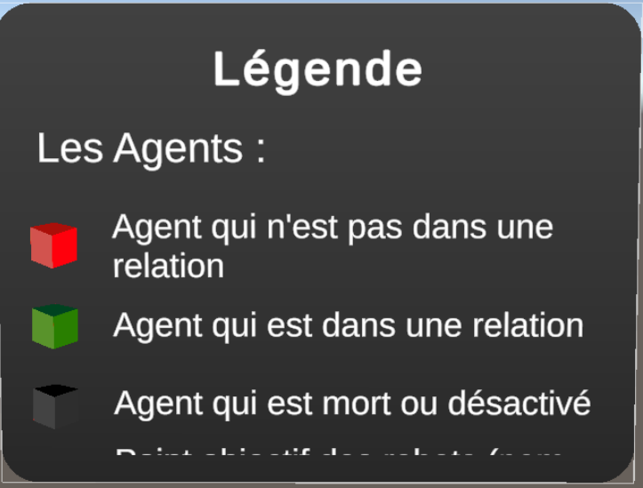
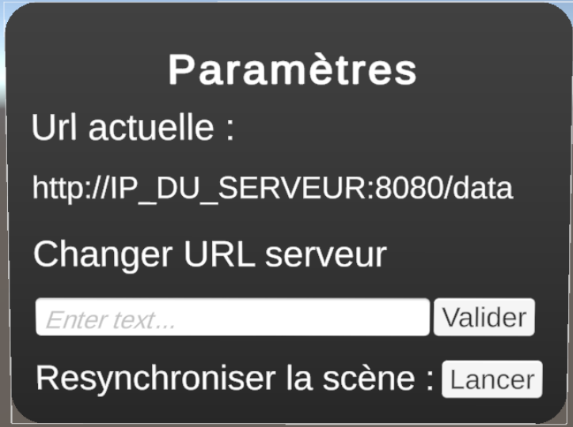
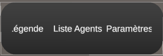
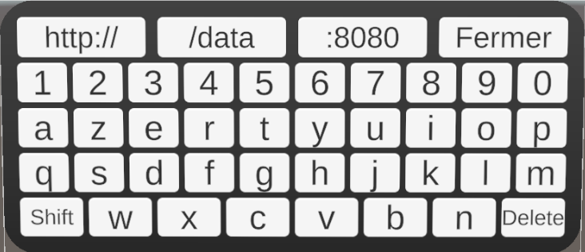

  🌐 <b>Select language / Choisir la langue :</b> 
  <a href="#lang-en"><b>🇬🇧 English</b></a> • <a href="#lang-fr"><b>🇫🇷 Français</b></a>

# 🇬🇧 English

# Making the Invisible Visible: Augmented Reality for Robotic Agent Communications

An augmented reality application (Unity, Meta Quest 3) that displays, in real time and within the physical space of a teaching factory, the messages exchanged between mobile robotic agents.

> Project carried out as part of the PIDR (Interdisciplinary Research Discovery Project) and continued during my 2-month internship at CRAN (Research Centre for Automatic Control of Nancy), in my second year at TELECOM Nancy.

---

## Context

- **Context**: a 3-month research discovery project (March to May 2026), carried out together with Bleunvenn AUDREN, then continued on my own during a 2-month internship (June to July 2026) at CRAN (Research Centre for Automatic Control of Nancy), Villers-lès-Nancy, supervised by Pascale Marangé and Rémi Pannequin.

- **Overall project**: the teaching factory platform aims to integrate new technologies, such as mobile robotics, into a production line. It is set in a strong current environmental context, as the concept of regeneration is at the heart of its concerns.

- **Problem addressed**: the platform relies on a complex multi-agent system whose operation remains opaque to non-expert users. Yet the platform is open to everyone, in particular students, which makes presenting it difficult. The goal of this augmented reality application is therefore to provide an educational presentation of the system's behavior, showing spatially how the agents behave.

## My Contribution

I designed and developed the **AR visualization application** on the headset side. A prototype of this application was built together with Bleunvenn AUDREN. The data server and the multi-agent model were part of the overall project and are not my work.

Both the PIDR and the internship led to written reports, which you can find below (in French only):
- **PIDR project report:** [Download the PIDR report](./docs/rapports/RapportPIDR2026_BleunvennAUDREN_AnneREGENNASS.pdf)
- **Internship report:** [Download the internship report](./docs/rapports/RapportStage2A_AnneRegennass.pdf)

## Implemented Features

### Synchronization with the real world
The user points at two reference positions (the robots' charging docks) with the controller. The application deduces the origin and orientation of the real-world frame and aligns the virtual scene with it.
To counter spatial drift, the user can restart this synchronization phase at any time from the settings menu.

### Display of communications between agents
Messages received from the server are represented by 3D tokens that move between the agents. Their appearance changes depending on the type of message being transmitted.

### Virtual reality menu
Menu opened with the controller or a finger pinch, with display settings, a legend, and a list of agents with their details.

  
  

The user can move between the different panels using a bar located below the active panel:

#### Virtual keyboard
Available in the settings menu so the user can change the address of the REST server.

## Architecture

Main components of the Unity scene:

- **WorldAligner / OrigineParentScene**: aligns the Unity frame with the real-world frame using the two synchronization points.
- **Rest To Json**: retrieval and deserialization of the server data.
- **ScenarioViewer / MessageAnimation**: display and animation of the received data.
- **MenuManager**: coordination of the menu panels.
- **Keyboard Manager**: management of the virtual keyboard.
- **OVRCameraRig**: headset camera, passthrough, and hand/controller tracking.

## Tech Stack

Unity 2022.3 · C# · Meta XR Core SDK · OpenXR · Android (IL2CPP, ARM64) · REST / JSON · TextMeshPro · Meta Quest 3

## Challenges Encountered

- **Spatial calibration**: how to precisely align the virtual and the real? How to counter spatial drift?
- **Network communication**: handling connection errors, processing received data
- **VR interactions**: collision detection, virtual keyboard, menu ergonomics

## Code Excerpts

The complete Unity project is not published (see below). The following scripts are provided to illustrate my work:

| Script | Role |
|---|---|
| [`WorldAligner.cs`](./Scripts/WorldAligner.cs) | Synchronizes the scene with the real environment |
| [`RestAgentJson.cs`](./Scripts/RestAgentJson.cs) | REST client and deserialization of received data |
| [`AgMessageAnimation.cs`](./Scripts/AgMessageAnimation.cs) | Animation of the message tokens |
| [`MenuManager.cs`](./Scripts/ScriptsMenu/MenuManager.cs) | Management of the menu panels |
| [`KeyboardManager.cs`](./Scripts/ScriptsMenu/ScriptsMenuParametres/KeyboardManager.cs) | Management of the virtual keyboard |

## About This Repository

This repository is a **showcase**: it presents the project and my code, but contains neither the Unity scene, nor the assets, nor the server, and is not designed to be built or run. The project is part of a broader research effort within the CRAN laboratory.

  <a href="#top">⬆️ <b>Back to top</b></a>

-----

# 🇫🇷 Français

# Rendre visible en réalité augmentée l'invisible des communications d'agents robotiques

Application de réalité augmentée (Unity, Meta Quest 3) qui affiche en temps réel, dans l'espace physique d'une usine-école, les échanges de messages entre agents robotiques mobiles.

> Projet réalisé dans le cadre du PIDR (Projet Interdisciplinaire ou de Découverte de la Recherche) et poursuivi lors de mon stage de 2 mois au CRAN (Centre de Recherche en Automatique de Nancy), dans le cadre de ma seconde année à TELECOM Nancy.

---

## Contexte

- **Cadre** : projet de découverte à la recherche réalisé sur 3 mois (de Mars à Mai 2026) en duo avec Bleunvenn AUDREN puis poursuivi seule en stage de 2 mois, de Juin à Juillet 2026 au CRAN (Centre de Recherche en Automatique de Nancy), Villers-lès-Nancy, encadré par Pascale Marangé et Rémi Pannequin.

- **Projet global** : la plateforme usine-école a pour objectif d'intégrer dans une chaîne de production les nouvelles technologies, comme la robotique mobile. Elle s'inscrit dans un contexte environnemental actuel fort puisqu'elle met au cœur de ses préoccupations le concept de régénération.

- **Problème adressé** : la plateforme fonctionne grâce à un système multi-agent complexe, dont le fonctionnement reste opaque pour des utilisateurs non initiés. Or cette plateforme est ouverte à tous, en particulier aux étudiants, ce qui rend sa présentation complexe. Cette application en réalité augmentée vise donc à offrir une présentation pédagogique de son comportement, en montrant spatialement comment les agents interagissent.

## Ma contribution

J'ai conçu et développé **l'application de visualisation AR** côté casque. Un prototype de cette application a été réalisé en duo avec Bleunvenn AUDREN. Le serveur de données et le modèle multi-agents faisaient partie du projet global et ne sont pas de moi.

Le PIDR et le stage ont tous deux permis la rédaction de rapports, que vous retrouverez uniquement en français ci-dessous :
- **Rapport de projet PIDR :** [Télécharger le rapport PIDR](./docs/rapports/RapportPIDR2026_BleunvennAUDREN_AnneREGENNASS.pdf)
- **Rapport de stage :** [Télécharger le rapport de stage](./docs/rapports/RapportStage2A_AnneRegennass.pdf)

## Fonctionnalités Implémentées

### Synchronisation avec le monde réel
L'utilisateur pointe deux positions de référence (les docks de charge des robots) avec la manette. L'application en déduit l'origine et l'orientation du repère réel et aligne la scène virtuelle dessus. 
Pour contrer les phénomènes de dérive spatiale, l'utilisateur peut, à tout moment, relancer cette phase de synchronisation à partir du menu de paramètres.

### Affichage des communications entre agents
Les messages reçus du serveur sont représentés par des jetons 3D qui se déplacent entre les agents. Leur apparence change en fonction du type de message qui est transmis.

### Menu en réalité virtuelle
Menu accessible à la manette ou par pincement des doigts : paramètres d'affichage, légende, liste et détails des agents. 

  
  

L'utilisateur peut se déplacer entre les différents panneaux à l'aide d'une barre située au-dessous du panneau actif : 

#### Clavier virtuel
Disponible dans le menu de paramètres pour permettre à l'utilisateur de modifier l'adresse du serveur REST.

## Architecture

Principaux composants de la scène Unity :

- **WorldAligner / OrigineParentScene** : calage du repère Unity sur le repère réel à partir des deux points de synchronisation.
- **Rest To Json** : récupération et désérialisation des données du serveur.
- **ScenarioViewer / MessageAnimation** : affichage et animation des données reçues.
- **MenuManager** : coordination des panneaux du menu.
- **Keyboard Manager** : gestion du clavier virtuel.
- **OVRCameraRig** : caméra du casque, passthrough et suivi des mains / manettes.

## Stack technique

Unity 2022.3 · C# · Meta XR Core SDK · OpenXR · Android (IL2CPP, ARM64) · REST / JSON · TextMeshPro · Meta Quest 3

## Défis rencontrés

- **Calibration spatiale** : Comment aligner précisément virtuel et réel ? Comment contrer la dérive spatiale ?
- **Communication réseau** : gestion des erreurs de connexion, traitement des données reçues
- **Interactions en VR** : détection des collisions, clavier virtuel, ergonomie du menu

## Extraits de code

Le projet Unity complet n'est pas publié (voir ci-dessous). Les scripts suivants sont fournis pour illustrer mon travail :

| Script | Rôle |
|---|---|
| [`WorldAligner.cs`](./Scripts/WorldAligner.cs) | Synchronise la scène avec l'environnement réel |
| [`RestAgentJson.cs`](./Scripts/RestAgentJson.cs) | Client REST et désérialisation des données reçues |
| [`AgMessageAnimation.cs`](./Scripts/AgMessageAnimation.cs) | Animation des jetons de messages |
| [`MenuManager.cs`](./Scripts/ScriptsMenu/MenuManager.cs) | Gestion des panneaux du menu |
| [`KeyboardManager.cs`](./Scripts/ScriptsMenu/ScriptsMenuParametres/KeyboardManager.cs) | Gestion du clavier virtuel |

## À propos de ce dépôt

Ce dépôt est une **vitrine** : il présente le projet et mon code, mais ne contient ni la scène Unity, ni les assets, ni le serveur, et n'est pas conçu pour être compilé ou exécuté. Le projet fait partie d'un travail de recherche plus large au sein du laboratoire du CRAN.

  <a href="#top">⬆️ <b>Retour en haut</b></a>

 